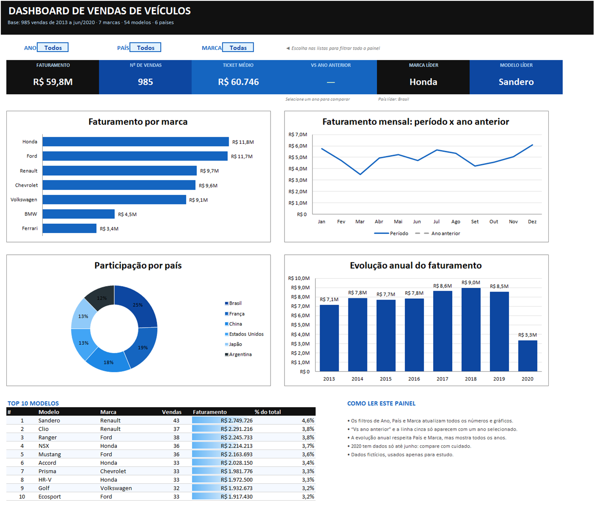
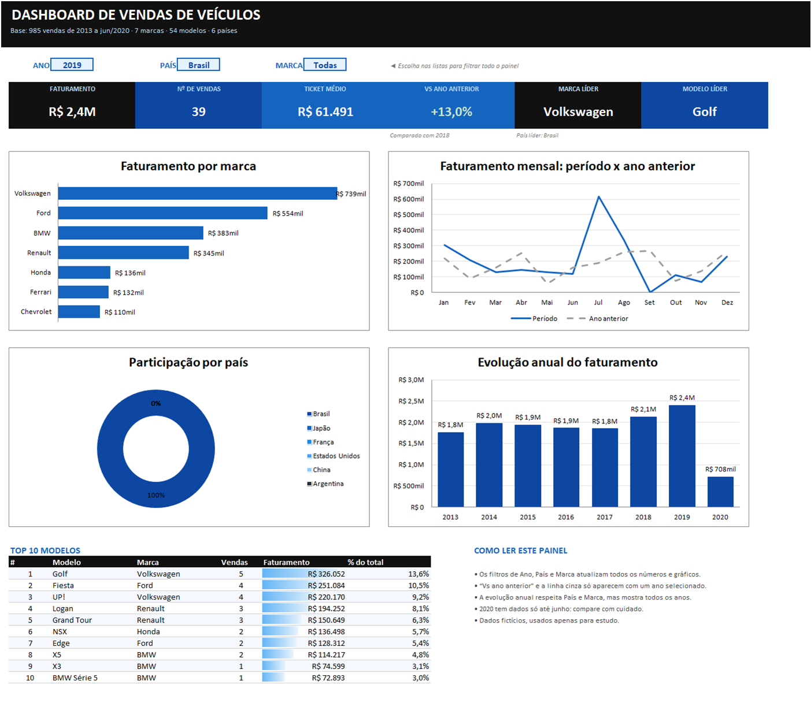
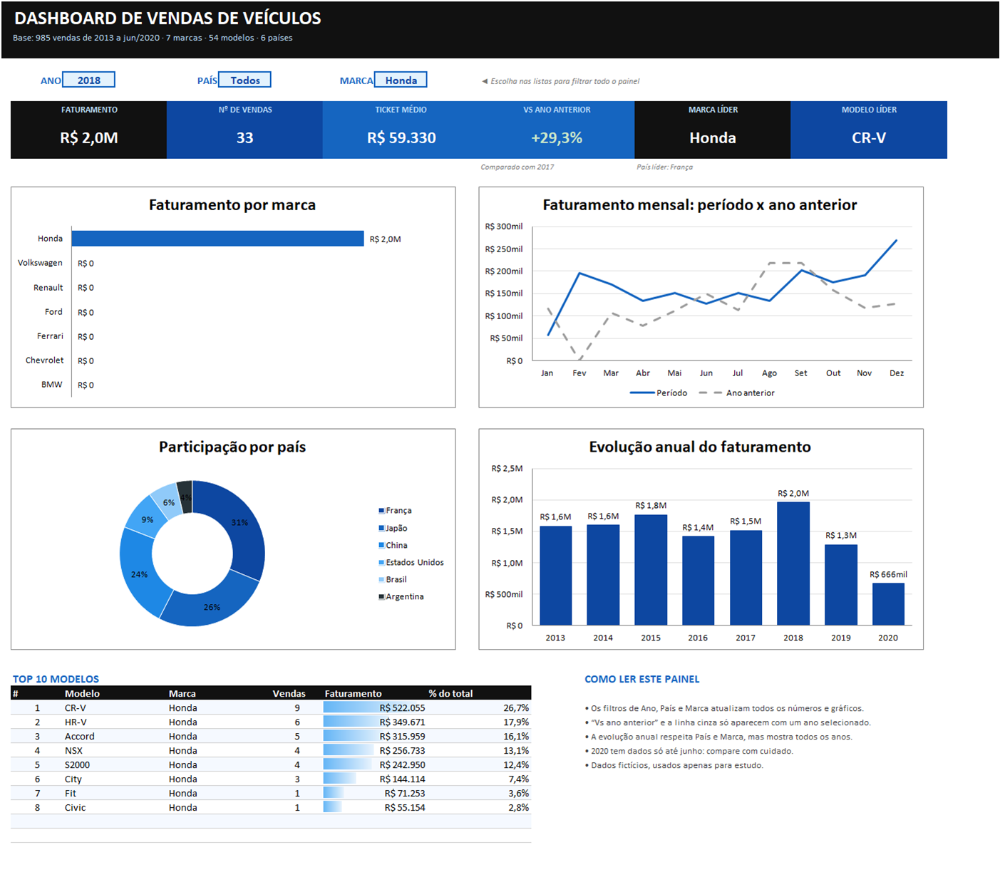

# Dashboard de Vendas de Veículos no Excel

Dashboard interativo em Excel que transforma uma base bruta de **985 vendas de veículos** (2013 a jun/2020) em indicadores e gráficos para analisar o desempenho comercial por **ano, país e marca**.

Projeto do Desafio de Projeto **Dashboard de Vendas** da DIO, na trilha *Reclame Aqui – Dados e IA na Prática*. Ele parte de um dashboard que eu já tinha feito no **Power BI** com a mesma base, agora reconstruído e ampliado no Excel.

📄 Arquivo principal: [`dashboard-vendas.xlsx`](dashboard-vendas.xlsx)



## O que o dashboard responde

| Pergunta | Onde ver |
|---|---|
| Quanto vendemos e quantas vendas foram? | Cartões **Faturamento** e **Nº de vendas** |
| Qual o valor médio de cada venda? | Cartão **Ticket médio** |
| Crescemos em relação ao ano anterior? | Cartão **Vs ano anterior** e linha cinza do gráfico mensal |
| Qual marca, modelo e país lideram? | Cartões **Marca líder** e **Modelo líder**, **País líder** e rosca por país |
| Como as vendas se distribuem no ano? | **Faturamento mensal: período x ano anterior** |
| Como o faturamento evoluiu ao longo dos anos? | **Evolução anual do faturamento** |
| Quais modelos mais faturam? | Tabela **Top 10 modelos**, com barras de dados |

## Como usar

1. Abra `dashboard-vendas.xlsx` na aba **Dashboard**.
2. Escolha **Ano**, **País** e **Marca** nas listas suspensas (células azul-claras no topo).
3. Todos os cartões, gráficos e o Top 10 se atualizam na hora.

| Brasil · 2019 | Honda · 2018 |
|---|---|
|  |  |

## Dados utilizados

Arquivo [`data/base_dados.xlsx`](data/base_dados.xlsx), aba `base`. São **dados fictícios** de estudo, com 985 linhas e 8 colunas:

| Coluna | Descrição |
|---|---|
| ID | Identificador da venda |
| MARCA / MODELO | 7 marcas e 54 modelos |
| PREÇO | Valor da venda |
| PAÍS / REGIÃO | 6 países e suas regiões |
| NOME | Cliente (fictício) |
| DATA | Data da venda (01/01/2013 a 21/06/2020) |

**Tratamentos aplicados** na aba `Base`:
- Nomes de países traduzidos para português (Brazil → Brasil, United States → Estados Unidos…).
- Modelos que vinham como número, como `500`, padronizados como texto.
- Colunas derivadas `Ano` e `Mês` (`ANO()` e `MÊS()`).
- Dados formatados como **Tabela do Excel** (`tbVendas`).

## Como funciona por dentro

A pasta de trabalho tem 3 abas:

| Aba | Papel |
|---|---|
| **Dashboard** | Filtros, cartões, gráficos e Top 10 |
| **Base** | Tabela `tbVendas` com os dados tratados e 3 colunas de filtro |
| **Cálculos** | Listas dos filtros, KPIs e rankings que alimentam os gráficos |

**Filtros sem segmentação de dados.** Os filtros são listas de **validação de dados** ligadas aos nomes `sel_ano`, `sel_pais` e `sel_marca`. Na Base, três colunas marcam com 1 as linhas que entram em cada visão:

```
Filtro atual        =SE(E(OU(sel_ano="Todos";C2=sel_ano); OU(sel_pais="Todos";H2=sel_pais); OU(sel_marca="Todas";E2=sel_marca));1;0)
Filtro ano anterior → mesma regra, com ano = sel_ano - 1
Filtro sem ano      → só país e marca (usado na evolução anual)
```

**KPIs** com `SOMASES` e `CONT.SES` sobre essas colunas, por exemplo `=SOMASES(Preço;Filtro atual;1)`.

**Rankings ordenados automaticamente** com `MAIOR` + `ÍNDICE`/`CORRESP`. Uma coluna de desempate (`faturamento + LIN()/1.000.000`) evita empates. Os gráficos de marca e país e o Top 10 leem essas tabelas já ordenadas.

**Formatação condicional:** variação positiva em verde e negativa em vermelho, e barras de dados no Top 10. As posições sem venda no filtro ficam em branco.

**Formatos personalizados** para valores compactos: `R$ 59,8M`, `R$ 554mil`.

## Principais insights (visão geral)

- **R$ 59,8 milhões** em 985 vendas, com **ticket médio de R$ 60.746**.
- **Honda** (R$ 11,8M) e **Ford** (R$ 11,7M) lideram quase empatadas em faturamento. O maior ticket médio é o da **Renault** (R$ 62,0 mil), e a **Ferrari** tem o menor volume (55 vendas).
- Os tickets médios das marcas são parecidos (R$ 60 mil a R$ 62 mil), o que reforça que a base é fictícia.
- O **Brasil** responde por **25%** do faturamento, seguido de França (19%) e China (18%).
- **2018** foi o melhor ano (R$ 9,0M). 2020 tem dados só até junho.
- O modelo que mais fatura é o **Renault Sandero** (R$ 2,7M).

## Do Power BI para o Excel: o que melhorei

A versão original em Power BI está em [`powerbi/dashboard-vendas.pbix`](powerbi/dashboard-vendas.pbix). Ela tinha filtros de ano e mês, KPI contra o ano anterior, treemap e barras por marca, cascata, pizza por país e lista de modelos.

No Excel eu mantive essas análises e acrescentei:
- Filtro de **País** e de **Marca**, além do Ano.
- Gráfico **mensal comparando com o ano anterior**, com a linha tracejada.
- **Evolução anual** de 2013 a 2020.
- Cartões de **ticket médio**, **marca líder**, **modelo líder** e **país líder**.
- **Top 10 modelos** ordenado automaticamente, com participação no total.
- Tradução e limpeza dos dados, e layout em preto, azul e branco.

## Como reproduzir

**Opção 1: usar o arquivo pronto.** Baixe `dashboard-vendas.xlsx` e abra no Excel 2016 ou mais recente. Não usa macros.

**Opção 2: gerar de novo a partir da base.** O script [`scripts/build_dashboard.py`](scripts/build_dashboard.py) monta a pasta de trabalho inteira com fórmulas, gráficos e formatação:

```bash
pip install openpyxl
python scripts/build_dashboard.py data/base_dados.xlsx dashboard-vendas.xlsx
```

Abra o arquivo gerado no Excel para que as fórmulas sejam calculadas.

**Opção 3: montar à mão.** Importe a base, converta em Tabela, crie as colunas Ano, Mês e Filtro, monte a aba de Cálculos com `SOMASES`/`MAIOR`/`ÍNDICE`/`CORRESP` e insira os gráficos apontando para ela.

## Tecnologias

Microsoft Excel (tabelas, validação de dados, nomes definidos, SOMASES, CONT.SES, ÍNDICE/CORRESP, MAIOR, formatação condicional e gráficos), Power BI (versão original) e Python com openpyxl (geração automatizada).
